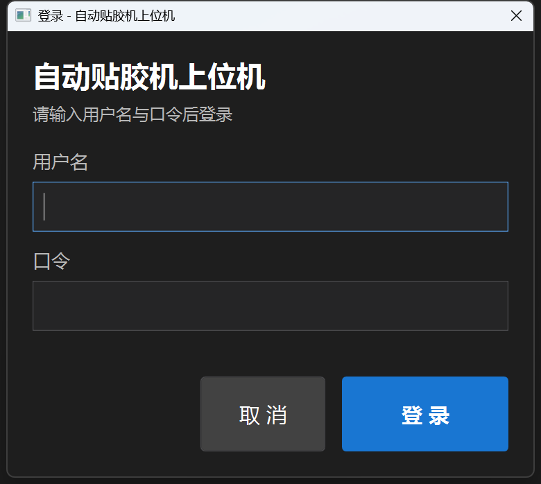
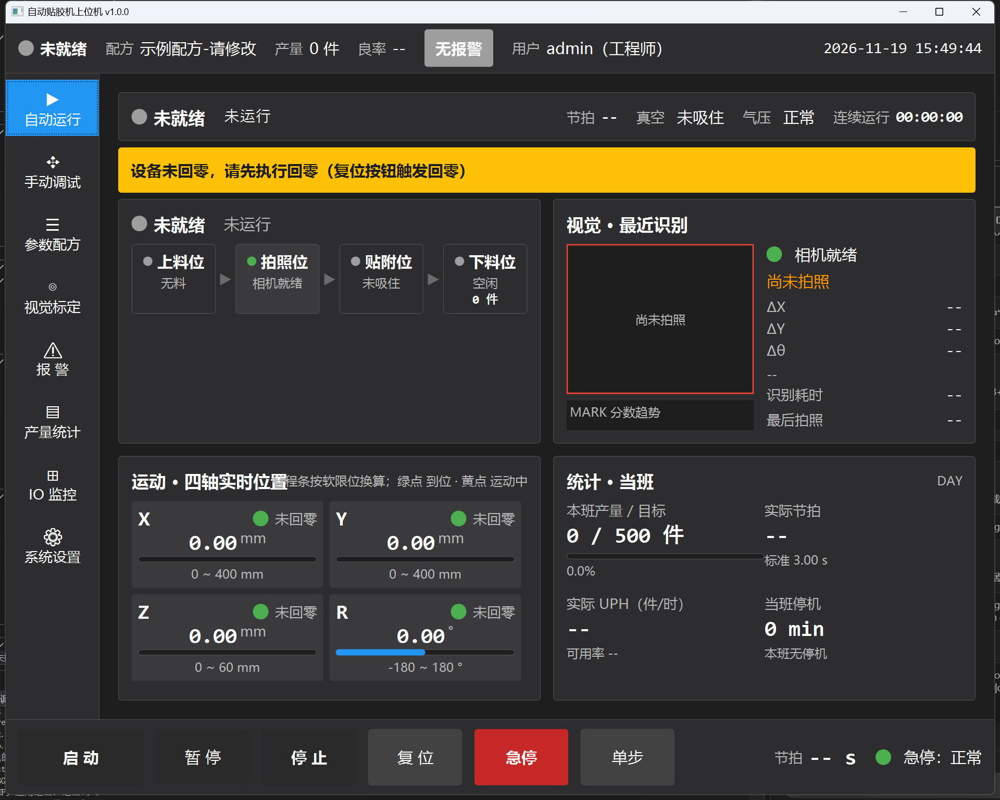
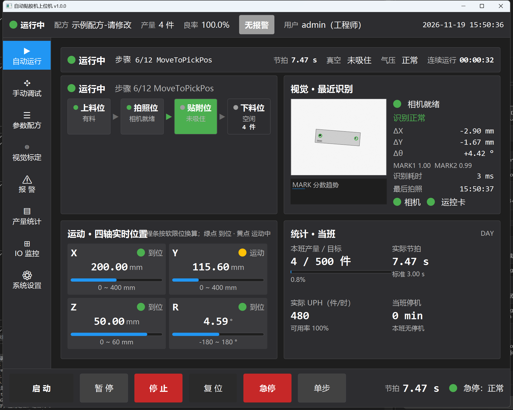
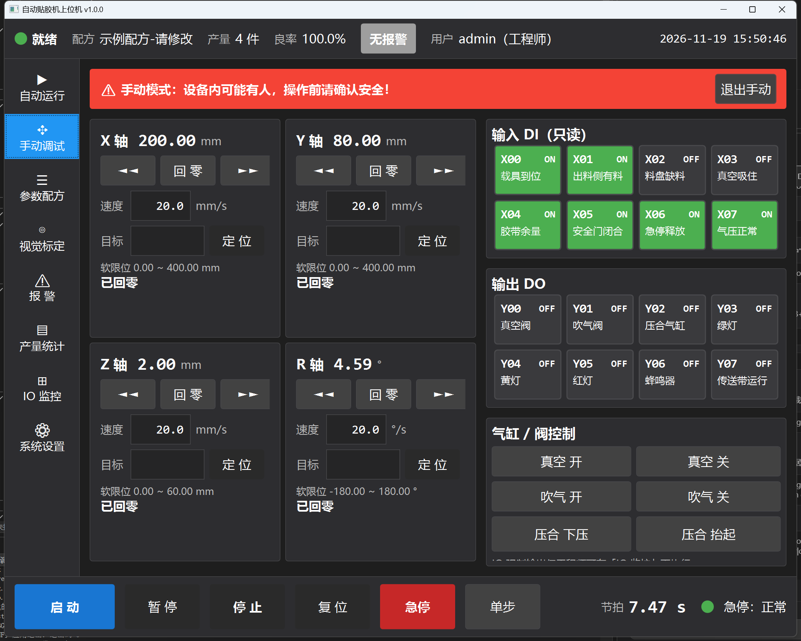
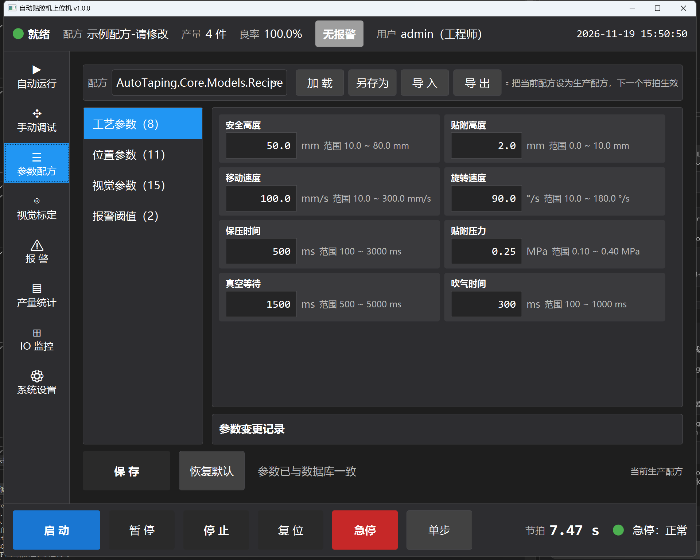
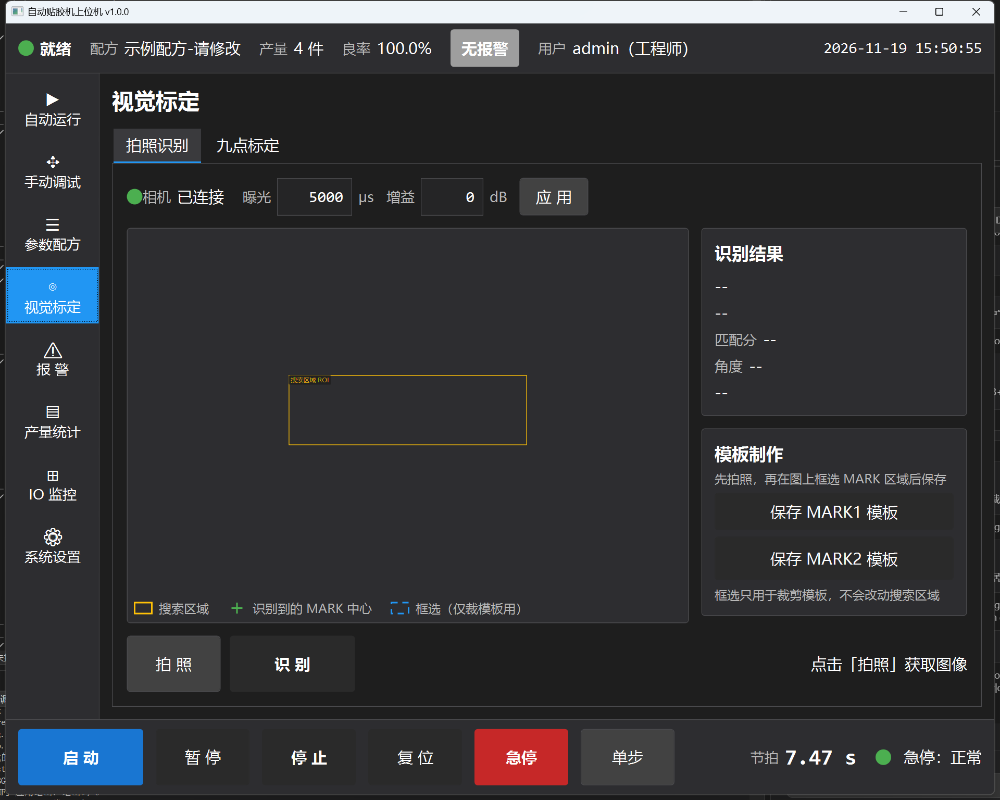
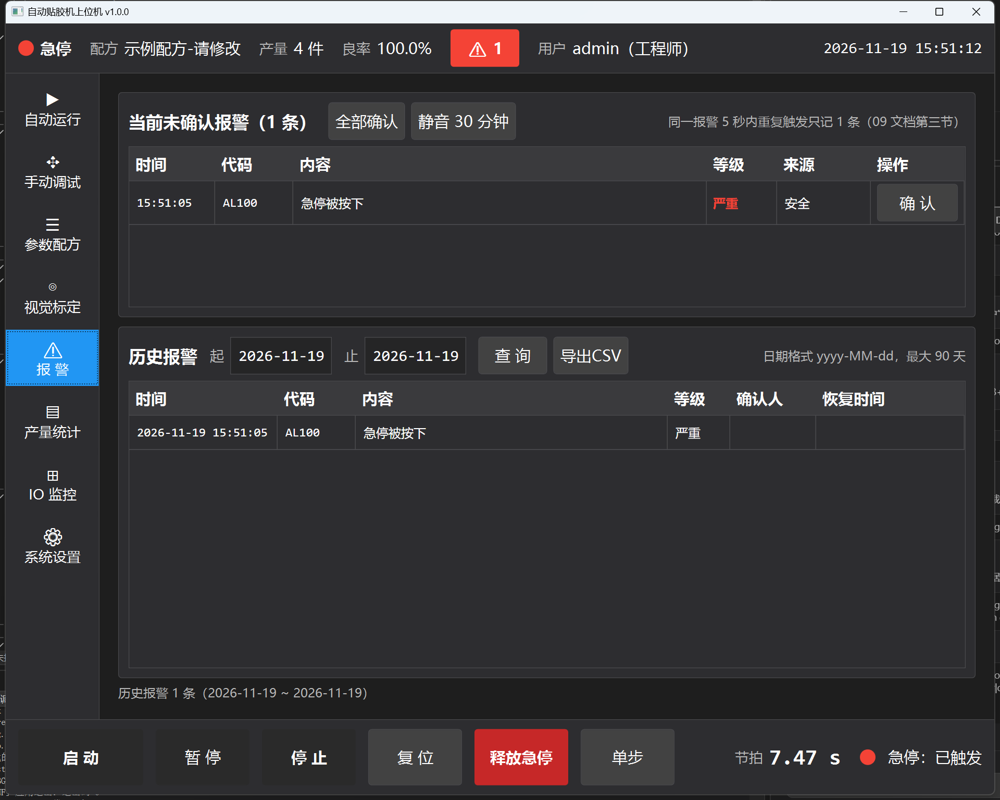
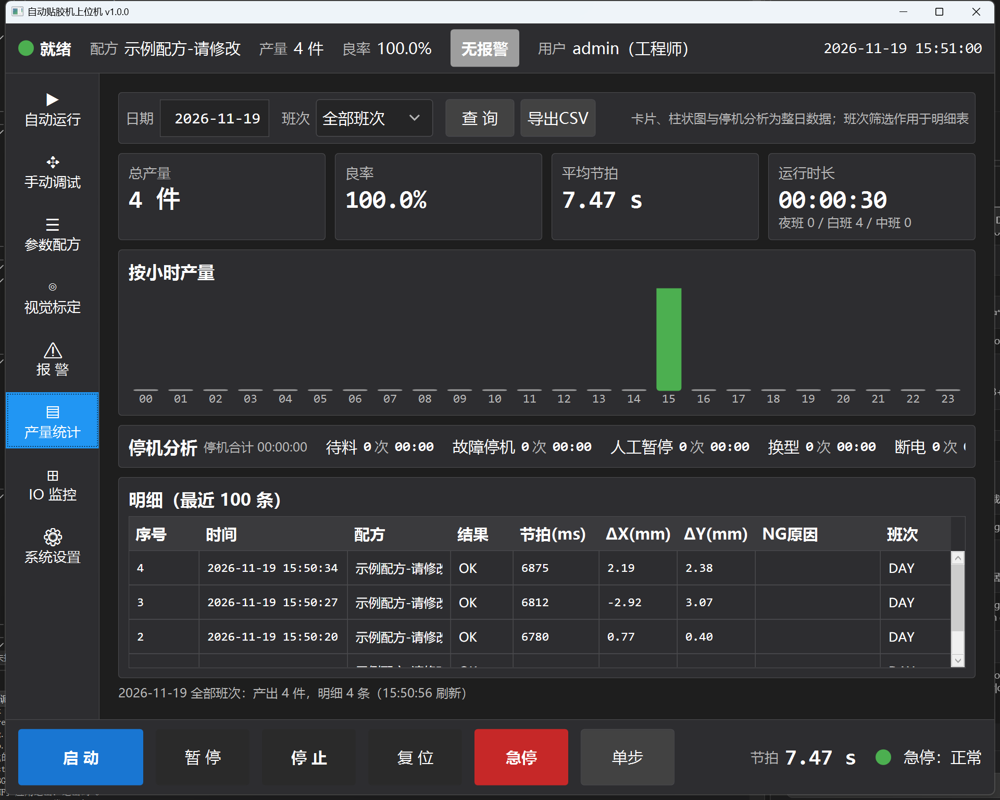
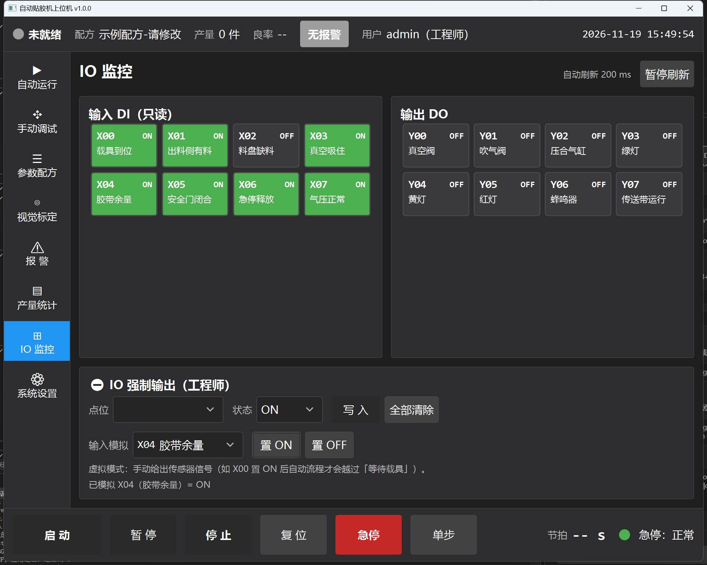
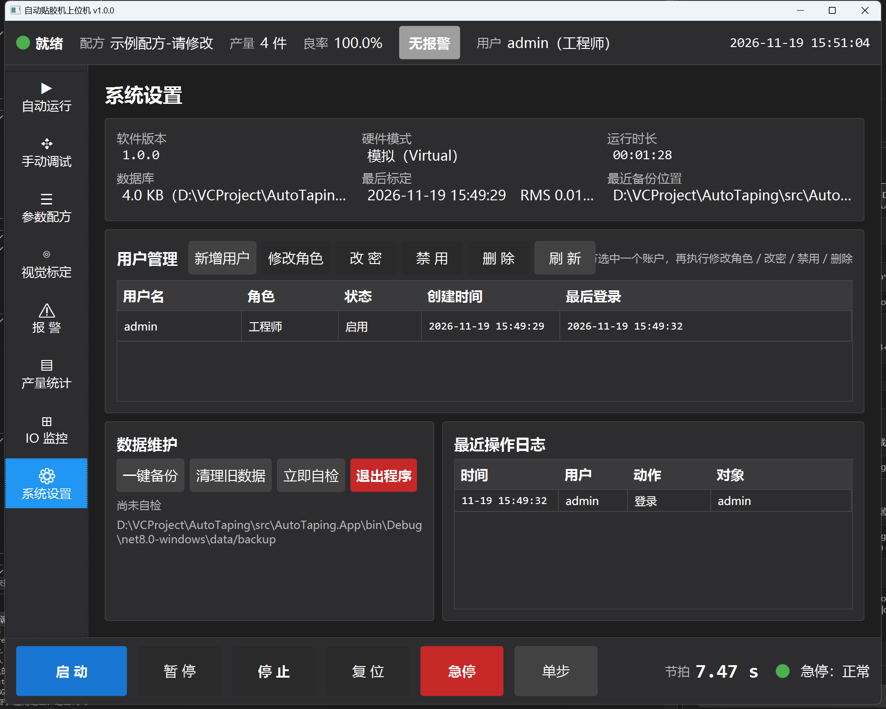

# 自动贴胶机上位机（AutoTaping HMI）

Windows 设备级上位机：视觉定位 + 四轴运动调度 + 贴附流程 + 配方/报警/产量/追溯。
.NET 8 + WPF + CommunityToolkit.Mvvm + SQLite（Dapper）+ OpenCvSharp；**单机部署，断网可完整运行**。

> 设计规格以 `docs/` 下 13 份文档为唯一权威（建议先读 `docs/README.md`）。
> 本文件讲**怎么装、怎么跑、界面长什么样、出问题怎么查**。

---

## 0. 界面导览

截图由脚本自动生成。

### 0.1 登录框

先登录再进主界面；无操作 5 分钟自动回登录框。



### 0.2 自动运行（主画面）

未回零时顶部黄条提示；四宫格分别是流程、视觉、运动、统计。




运行中：状态灯转绿，顶部显示当前步骤（示例 6/12 MoveToPickPos）。
视觉区给出 ΔX/ΔY/Δθ 与两个 MARK 的匹配分；统计区是本班产量、节拍、UPH、停机。

### 0.3 手动调试

进入需二次确认；可点动、回零、定位。



### 0.4 参数配方

36 项参数分 4 组，带范围校验与变更记录。



### 0.5 视觉标定

拍照识别与九点标定两个页签，可现场做 MARK 模板。



### 0.6 报 警

当前未确认报警 + 历史查询/导出；截图是触发急停后的 AL100。



### 0.7 产量统计

总产量/良率/节拍/按小时柱状图/停机分析/逐件明细（含 ΔX ΔY）。



### 0.8 IO 监控

DI/DO 200ms 刷新；虚拟模式下可手动模拟输入（X00 放行载具）。



### 0.9 系统设置

用户管理、一键备份、自检、操作日志与版本信息。



### 0.10 截图怎么来的

`tools/capture-screenshots.ps1` 会启动程序、登录、逐页截图。

用 UIAutomation 点按钮，靠虚拟 IO 模拟载具到位跑通整套流程后再取图。

```powershell
powershell -File tools\capture-screenshots.ps1
```

## 1. 解决方案结构

```
AutoTaping/
├── AutoTaping.sln
├── docs/                      # 需求与设计文档（00~12）
├── src/
│   ├── AutoTaping.App/        # WPF 主程序：DI、主窗口、8 个页面
│   ├── AutoTaping.Core/       # 领域层：状态机、流程引擎、报警/产量/用户服务（无 UI、无 SQL）
│   ├── AutoTaping.Hardware/   # 雷赛运控卡 / 海康相机 / Virtual 实现
│   ├── AutoTaping.Vision/     # 标定、模板匹配、纠偏
│   ├── AutoTaping.Data/       # SQLite + Dapper：表结构、仓储、备份、每日维护
│   └── AutoTaping.Tests/      # xUnit 单元测试
├── tools/                     # 相机冒烟测试、截图脚本、样本图生成
├── packages-local/            # 离线 NuGet 包（无外网时用）
└── NuGet.config               # 指向本地包源
```

---

## 2. 环境要求

| 项 | 要求 |
|---|---|
| 操作系统 | Windows 10 / 11（工控机建议 Windows 10 LTSC） |
| 运行时 | .NET 8 Desktop Runtime（或使用 self-contained 发布，免安装） |
| 屏幕 | 1280×1024 起（150% DPI 已验证） |
| 数据库 | 无需安装，首次启动自动建 `data/autotaping.db` |
| 网络 | 不需要外网；仅相机走局域网 |

---

## 3. 开发环境构建与运行

```powershell
# 还原 + 编译（离线可用，NuGet 源指向 packages-local）
dotnet build AutoTaping.sln

# 运行（无硬件：appsettings.json 里 Hardware:UseVirtual = true）
dotnet run --project src/AutoTaping.App

# 单元测试
dotnet test src/AutoTaping.Tests
```

首次启动流程：建库（9 张表 + 种子数据）→ 硬件自检（失败降级 Virtual 并报警）→ 启动自检（磁盘/数据库）→
启动每日维护任务 → 登录框 → 主窗口。

**默认账号**：`admin` / `123456`（工程师）。首次交付请立刻在「系统设置 → 用户管理 → 改密」修改。

---

## 4. 发布到工控机

```powershell
# 方式 A：依赖已安装的 .NET 8 Desktop Runtime
dotnet publish src/AutoTaping.App -c Release -r win-x64 --self-contained false -o publish

# 方式 B：完全自包含（工控机不装运行时，体积约 150 MB）
dotnet publish src/AutoTaping.App -c Release -r win-x64 --self-contained true -o publish
```

把 `publish/` 整个目录拷到工控机（例如 `D:\AutoTaping\`），双击 `AutoTaping.App.exe` 即可。

发布目录中会被读写的子目录（首次启动自动创建）：

| 目录 / 文件 | 内容 | 说明 |
|---|---|---|
| `appsettings.json` | 硬件参数、IO 映射、维护与备份配置 | 装机时按电气图修改，**改动前先备份** |
| `data/autotaping.db` | SQLite 数据库（配方/报警/产量/用户/标定/停机） | 不要手工编辑 |
| `data/archive/` | 每日维护归档的 CSV | 产出 90 天、报警 180 天、操作日志 365 天后归档 |
| `data/backup/` | 一键备份 zip | 保留最近 30 份（`Backup:KeepCount`） |
| `logs/` | Serilog 日志，按天滚动 | 保留 90 天 |
| `templates/{配方}/` | MARK 模板图 | 由视觉页「框选保存模板」生成 |
| `images/calibration/` | 标定原图 | 每次标定一个目录 |

### 4.1 开机自启（可选）

用「任务计划程序」创建触发器「登录时」，操作指向 `AutoTaping.App.exe`，起始目录填发布目录
（必须填，否则相对路径会落到 `system32`）。

---

## 5. 配置说明（`appsettings.json`）

| 段 | 关键项 | 说明 |
|---|---|---|
| `Hardware:UseVirtual` | `true` / `false` | 无硬件调试必须为 `true`；接真机改 `false` |
| `Hardware:MotionCard:Axes` | `PulsePerMm`、`MinLimit`、`MaxLimit`、速度/加减速/回零 | 出厂参数，改动后必须重新标定 |
| `Hardware:Camera` | `ExposureTime`、`Gain`、`TriggerMode`、`TimeoutMs` | 先调曝光再调增益 |
| `Io:DiMap` / `Io:DoMap` | 点位号 → 中文名 | 与电气图一致，界面按此显示 |
| `Io:InitialDiStates` | 虚拟模式的 DI 初值 | 仅 `UseVirtual=true` 生效 |
| `Security:AutoLockMinutes` | 默认 5 | 无操作自动回登录页（运行中不锁） |
| `Storage` | 数据库/日志路径、日志保留天数 | 相对路径按程序目录解析 |
| `Maintenance` | 保留天数、归档目录、执行时刻、标定保留条数 | 默认每天 02:00 执行一次 |
| `Backup` | 备份目录、保留份数 | 目录可改到外置盘 |
| `SelfCheck` | 数据目录、磁盘下限（GB）、巡检周期（秒） | 磁盘低于下限报警 `AL501`；数据库不可写报警 `AL502` |

配置损坏时软件**不会拒绝启动**：使用默认值启动并记日志（对应报警 `AL504` 的语义）。

---

## 6. 数据备份与恢复

**备份**：系统设置页 →「一键备份」。生成 `data/backup/autotaping_backup_yyyyMMdd_HHmmss.zip`，
内含 `data/autotaping.db`（SQLite 在线备份，备份期间可继续生产）、`recipes/`、`templates/`、`appsettings.json`。

**恢复（人工）**：

1. 退出程序（系统设置页 →「退出程序」，确保写入正常退出标记）。
2. 把 `data/` 目录整体改名备份（例如 `data.bak`）。
3. 解压备份包到发布目录，覆盖 `data/`、`recipes/`、`templates/`、`appsettings.json`。
4. 启动程序 → 登录 →「产量统计」核对条数与良率 →「报警」核对历史 →「用户管理」核对账户。

> 恢复后请在「视觉标定」页确认当前生效标定是否为现场那一次（版本信息区会显示最后标定时间与 RMS）。

---

## 7. 日常维护

- **自动**：每天 02:00 后台执行一次——过期产出/报警/操作日志先归档成 CSV（`data/archive/`）再删除，
  标定记录只保留最近 20 条（含原图目录），过期日志文件清理。进程异常退出也不会丢数据（先写 CSV 再删库）。
- **手动**：系统设置页 →「清理旧数据」（工程师权限，二次确认）。
- **巡检**：自检服务每分钟检查磁盘剩余与数据库可写性，条件变化时报警/自动恢复。

---

## 8. 常见问题（FAQ）

| 现象 | 原因 | 处理 |
|---|---|---|
| 启动后提示「运控卡未连接，已降级为模拟模式」并报警 `AL105` | 真实模式下 `LTDMC.dll` 未找到 / 卡未插好 / 位宽不匹配 | 检查驱动与 `Hardware:UseVirtual`；确认卡型号与 P/Invoke 一致。降级后软件仍可用（Virtual） |
| 提示「相机未连接，已降级为模拟相机」并报警 `AL201` | 相机未上电、IP 不同网段、MVS SDK 未安装 | `ping` 相机 IP；确认安装了 MVS 且 `MvCameraControl.Net.dll` 在程序目录；3 秒后自动重连 |
| 点「启动」提示「4 轴未全部回零」 | 未回零 | 手动页回零，或操作条「复位」触发回零 |
| 点「启动」提示「安全门未闭合 / 气压不足 / 存在未确认的严重报警」 | 互锁不满足 | 一次列全所有原因，逐项排除后重试 |
| 报警 `AL501` 磁盘空间不足 | 剩余 < 1 GB | 系统设置页「一键备份」后清理旧备份/归档，或调小 `Maintenance` 保留天数 |
| 报警 `AL502` 数据库写入失败 | 库只读、目录无写权限、磁盘满、被其他程序占用 | 检查 `data/` 权限与磁盘；生产不会因写库失败中断，但该件产出记录会丢失（有日志） |
| 导出 CSV 用 Excel 打开中文乱码 | 非本软件导出 / 被其他工具改写编码 | 本软件导出固定 UTF-8 with BOM；不要用记事本另存为 ANSI |
| 登录提示「该账户已被禁用」 | 工程师在用户管理里禁用了该账户 | 用其他工程师账户启用 |
| 忘记 admin 密码 | — | 见下方「应急重置」 |
| 界面无操作几分钟后回到登录框 | 自动锁屏（`Security:AutoLockMinutes`） | 正常行为；设备运行中不会锁屏 |
| `dotnet restore` 报 SSL 错误 | 本机访问 `api.nuget.org` 失败 | 使用仓库自带 `NuGet.config`（本地 `packages-local`）；新增包时用 `nuget.azure.cn` 下载后放入 |

**应急重置 admin 密码**：停软件 → 备份 `data/autotaping.db` → 用任意 SQLite 工具执行
`DELETE FROM User WHERE UserName='admin';` → 启动软件（会重新写入种子 `admin`/`123456`，角色工程师）。
重置后立即改密，并核对用户列表是否还有其他被删除的账户。

---

## 9. 开发与验收

- 编码红线见 `docs/10-编码约定与AI须知.md`（分层、异步、日志、测试要求）。
- 分阶段交付物与验收标准见 `docs/11-开发任务分解.md`。
- S9 的交付物清单、验收自检结论与压测报告见 `docs/12-S9-验收与压测报告.md`。
- 已知偶发：`AutoFlowCoordinatorTests` 全流程用例在全量并行跑时偶尔超时，重跑即过。

```powershell
dotnet build AutoTaping.sln        # 期望 0 error
dotnet test src/AutoTaping.Tests   # 期望全部通过（当前 165 个用例）
```

---

## 10. 版本

| 阶段 | 内容 | 状态 |
|---|---|---|
| S0 | 骨架（DI + Serilog + 空窗口） | ✅ |
| S1 | 数据层（SQLite + 9 表 + 种子数据） | ✅ |
| S2 | 硬件抽象 + Virtual 实现 | ✅ |
| S3 | 主窗口壳（状态栏/导航/操作条/登录/锁屏） | ✅ |
| S4 | 手动页 + IO 页 | ✅ |
| S5 | 视觉模块 + 标定页 | ✅ |
| S6 | 状态机 + 自动流程（虚拟跑通单件） | ✅ |
| S7 | 参数 / 报警 / 产量 | ✅ |
| S8 | 真实硬件接入（代码层） | ✅（现场验收待做） |
| S9 | 打磨与验收（维护/备份/用户/自检/README/报告） | ✅（4 项待现场确认） |

软件版本：`v1.0.0`（显示在主窗口标题与系统设置页）。
